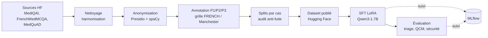

# Agent IA de triage médical : fine-tuning d'un LLM pour les urgences


POC d'un assistant qui aide l'infirmier d'accueil des urgences à **classer un
patient en 3 niveaux de priorité** à partir de la description du cas clinique,
avec une explication de la décision. Le projet couvre toute la chaîne d'un LLM
spécialisé : constitution d'un dataset médical bilingue anonymisé, fine-tuning
SFT LoRA d'un petit modèle open source, évaluation rigoureuse et suivi des
expériences.

> Projet 14 (projet final) de la formation **AI Engineer** d'OpenClassrooms.
> Le scénario (Centre Hospitalier Saint-Aurélien) est pédagogique : **ce modèle
> n'est pas un dispositif médical** et ne doit pas servir à trier de vrais patients.

## Sommaire

- [Contexte](#contexte)
- [Résultats](#résultats)
- [Démarche](#démarche)
- [Structure du projet](#structure-du-projet)
- [Installation sur un nouvel ordinateur](#installation-sur-un-nouvel-ordinateur)
- [Utilisation](#utilisation)
- [Suivi des expériences (MLflow)](#suivi-des-expériences-mlflow)
- [Limites](#limites)
- [Feuille de route](#feuille-de-route)

## Contexte

Le Centre Hospitalier Saint-Aurélien (CHSA) fait face à des pics d'affluence
aux urgences. Il veut évaluer en 4 semaines si un agent IA peut **assister le
tri des patients** à l'accueil :

| Niveau | Libellé | Exemple |
|---|---|---|
| **P1** | Urgence maximale | détresse respiratoire, SpO2 à 80 %, choc |
| **P2** | Urgence modérée | douleur importante, constantes stables |
| **P3** | Prise en charge différée | symptômes bénins, pas de signe de gravité |

Contraintes du cahier des charges :

- modèle **open source et léger**, hébergeable par l'hôpital
  (`Qwen/Qwen3-1.7B-Base`) ;
- données **anonymisées (RGPD)**, sources et licences documentées ;
- **traçabilité** des entraînements et des décisions ;
- priorité à la **sécurité** : le sous-triage (classer un patient moins urgent
  qu'il ne l'est) est l'erreur la plus grave.

Livrables : dataset publié, modèle fine-tuné avec métriques, endpoint de
démonstration (FastAPI + vLLM), CI/CD, rapport technique.

## Résultats

Prédiction du niveau par log-probabilité de chaque libellé, règle de décision
choisie sur la validation puis appliquée telle quelle au test. Les splits sont
regroupés par cas clinique pour éviter toute fuite entre entraînement et test.

| Expérience | Accuracy val. | Accuracy test | F1 macro test | Rappel P1 test | Sous-triage test |
|---|---|---|---|---|---|
| Baseline naïve (toujours P1) | 34,4 % | 40,8 % | 19,3 % | 100 % | 0,0 % |
| Qwen3-1.7B de base | 31,0 % | 27,8 % | 17,7 % | 6,7 % | 64,2 % |
| SFT médical (sans triage) | 29,5 % | 32,2 % | 25,7 % | 45,4 % | 38,2 % |
| **SFT médical + triage** | **62,6 %** | **78,8 %** | **78,7 %** | **86,5 %** | **7,0 %** |

- Seul le modèle entraîné sur des exemples de triage dépasse nettement la
  baseline : **+46,5 points** d'accuracy face au SFT médical généraliste
  (IC 95 % bootstrap [36,0 ; 55,8]).
- Aucun patient P1 n'est classé P3 sur le test.
- Validation et test sont petits (76 et 72 groupes de cas) : la performance
  attendue sur de nouveaux cas se situe **entre 62,6 % et 78,8 %**, les deux
  chiffres sont donnés ensemble.

Protocole complet, matrices de confusion et tests de robustesse :
[`docs/comparaison_triage.md`](docs/comparaison_triage.md).

## Démarche



1. **Données** : 3 sources médicales libres (FR/EN), nettoyées, dédoublonnées et
   validées par schémas Pandera. Anonymisation RGPD avec Presidio (modèles
   spaCy `fr_core_news_md` / `en_core_web_md`).
2. **Annotation** : niveau de priorité attribué à chaque cas clinique selon une
   grille inspirée de l'échelle FRENCH (SFMU) et du Manchester Triage System
   ([`docs/triage_grid.md`](docs/triage_grid.md)).
3. **Splits anti-fuite** : regroupement par cas, famille de cas et similarité
   TF-IDF ; audit automatique (aucun cas de test à plus de 0,49 de similarité
   avec l'entraînement).
4. **Dataset publié** : 6 747 paires instruction-réponse (train 5 398 /
   validation 675 / test 674), avec métadonnées cliniques (âge, sexe,
   symptômes, antécédents, constantes vitales, source, licence) :
   [christophe-ringot/p14-medical-triage-sft](https://huggingface.co/datasets/christophe-ringot/p14-medical-triage-sft)
   (CC BY 4.0).
5. **Fine-tuning** : SFT LoRA (r = 16, α = 32, q/k/v/o_proj, lr 2e-4,
   3 epochs, loss sur la réponse seule, meilleur checkpoint sur la loss de
   validation).
6. **Évaluation** : 4 expériences comparées sur les mêmes splits, intervalles de
   confiance bootstrap, analyse des erreurs, QCM FrenchMedMCQA et contrôle des
   conseils dangereux.

| Source | Langue | Licence | Usage |
|---|---|---|---|
| [MediQAl](https://huggingface.co/datasets/ANR-MALADES/MediQAl) (OEQ) | FR | CC BY 4.0 | cas cliniques, triage |
| [FrenchMedMCQA](https://huggingface.co/datasets/qanastek/frenchmedmcqa) | FR | Apache 2.0 | QCM médicaux |
| [MedQuAD](https://huggingface.co/datasets/keivalya/MedQuad-MedicalQnADataset) | EN | CC BY 4.0 | questions-réponses médicales |

## Structure du projet

```
.
├── src/triage/                 # package Python installable
│   ├── data/                   # collecte, nettoyage, anonymisation, annotation,
│   │                           # construction des datasets, audit, export Hugging Face
│   ├── schemas/                # schémas Pandera (corpus, dataset HF, DPO)
│   ├── training/               # fine-tuning SFT LoRA
│   ├── evaluation/             # triage, QCM, analyse des erreurs, sécurité
│   └── utils/                  # chargement du dataset HF, suivi MLflow, texte
├── docs/                       # protocole, résultats, journal des expériences, RGPD
├── outputs/                    # rapports et métriques versionnés (poids exclus)
├── docker/                     # image d'entraînement GPU et dépendances figées
├── docker-compose.yml          # serveur MLflow + entraînement
└── pyproject.toml              # métadonnées du package et dépendances
```

`data/`, `mlflow/` et les poids des modèles ne sont pas versionnés.

## Installation sur un nouvel ordinateur

### Prérequis

| Outil | Version | Utilité |
|---|---|---|
| [Git](https://git-scm.com/) | récent | cloner le repo |
| [Python](https://www.python.org/downloads/) | 3.11 | exécuter le code |
| GPU NVIDIA + pilote récent | ≥ 6 Go de VRAM (testé sur RTX 2060) | entraînement et évaluation |
| [Docker Desktop](https://www.docker.com/products/docker-desktop/) | backend WSL2 sous Windows | serveur MLflow, entraînement conteneurisé |
| Compte [Hugging Face](https://huggingface.co/join) | optionnel | seulement pour republier le dataset |

Sans GPU, le code tourne sur CPU, mais l'entraînement complet devient
impraticable ; le mode `--quick` reste utilisable pour tester la chaîne.

### 1. Cloner le repo

```bash
git clone https://github.com/Christophe-Ringot/OC_P14_finetuning.git
cd OC_P14_finetuning
```

### 2. Créer l'environnement virtuel

Windows (PowerShell) :

```powershell
python -m venv .venv
.venv\Scripts\Activate.ps1
python -m pip install --upgrade pip
```

Linux / macOS :

```bash
python3.11 -m venv .venv
source .venv/bin/activate
python -m pip install --upgrade pip
```

### 3. Installer PyTorch avec CUDA

À faire **avant** le reste, sinon pip installe la version CPU de PyTorch :

```bash
pip install torch==2.6.0 --index-url https://download.pytorch.org/whl/cu124
```

### 4. Installer le projet

```bash
pip install -e .
```

Pour reconstruire le dataset depuis les sources (anonymisation), ajouter
l'option `data` et les modèles spaCy :

```bash
pip install -e ".[data]"
python -m spacy download fr_core_news_md
python -m spacy download en_core_web_md
```

### 5. Vérifier l'installation

```bash
python -c "import torch, triage; print('GPU :', torch.cuda.is_available())"
```

La commande doit afficher `GPU : True`. Le dataset et le modèle de base sont
téléchargés automatiquement depuis Hugging Face au premier lancement (aucun
compte requis).

### 6. Démarrer MLflow

```bash
docker compose up -d mlflow
```

Interface : <http://localhost:5000>.

### 7. Test rapide de bout en bout

```bash
python -m triage.training.train_sft --quick
```

Entraîne les deux SFT sur 200 exemples (1 epoch) puis évalue sur 30 questions
par split : de quoi valider l'installation avant un entraînement complet.

## Utilisation

Toutes les commandes se lancent **depuis la racine du repo**, environnement
virtuel activé.

### Entraînement et évaluation

```bash
python -m triage.training.train_sft           # 2 SFT puis évaluation du triage -> outputs/triage_eval/
python -m triage.evaluation.analyze_triage    # calibration, métriques par cas, bootstrap
python -m triage.evaluation.error_analysis    # analyse des erreurs
python -m triage.evaluation.evaluate_mcqa     # QCM FrenchMedMCQA du test
```

Options utiles de `train_sft` : `--only 4_sft_medical_triage` (une seule
expérience), `--no-eval`, `--no-mlflow`.

### Tout lancer avec Docker

```bash
docker compose --profile train up -d --build
docker compose logs -f train
```

Démarre MLflow, construit l'image GPU, entraîne les deux SFT puis lance
l'évaluation (environ 14 h sur RTX 2060). Test rapide :
`docker compose --profile train run --rm train --quick`.

### Reconstruire le dataset

Nécessite l'option `[data]` et l'accès aux fichiers d'annotation (`data/`, non
versionné) :

```bash
python -m triage.data.collect_sources
python -m triage.data.clean_harmonize
python -m triage.data.anonymize
python -m triage.data.build_annotation_pool
python -m triage.data.annotate_priority
python -m triage.data.build_sft_datasets
python -m triage.data.audit_splits
python -m triage.data.export_hf_dataset
```

L'entraînement lit le dataset Hugging Face à une révision figée dans
[`src/triage/utils/hf_dataset.py`](src/triage/utils/hf_dataset.py) : après une
nouvelle publication, mettre à jour `DATASET_REVISION`.

## Suivi des expériences (MLflow)

Chaque exécution est enregistrée dans l'expérience `triage-sft` :

- **run d'entraînement** : hyperparamètres, courbes de loss train/validation,
  métriques système (CPU, GPU, mémoire), révision et empreinte du dataset,
  commit git, adaptateur LoRA final, puis métriques de triage sur la
  validation et le test ;
- **run d'évaluation** : métriques des 4 expériences, règle de décision
  retenue, rapports et prédictions en artefacts.

Les scripts vérifient que le serveur MLflow répond avant de démarrer, pour
éviter un entraînement de plusieurs heures sans suivi.

## Limites

- Les niveaux de priorité de référence sont **pré-annotés par LLM** selon une
  grille documentée, **sans validation clinique** par un médecin urgentiste.
- Jeux de validation et de test réduits (moins de 80 groupes de cas chacun) :
  intervalles de confiance larges.
- Le sous-triage persiste (7,0 % en test, 16,2 % en validation) : un usage
  réel imposerait une validation humaine systématique des cas P2/P3.
- Modèle de 1,7 milliard de paramètres : connaissances médicales limitées,
  risque d'hallucination dans les explications.

## Feuille de route

- [x] Dataset SFT anonymisé, annoté et publié sur Hugging Face
- [x] SFT LoRA, suivi MLflow, évaluation comparative du triage
- [ ] Alignement DPO ciblé sur le sous-triage
- [ ] API FastAPI + vLLM en Docker (authentification, logs de chaque décision)
- [ ] Déploiement de l'endpoint de démonstration sur un cloud GPU
- [ ] CI/CD GitHub Actions (tests, build de l'image, déploiement des versions du modèle)
- [ ] Rapport technique : méthode, métriques, check-list go/no-go, monitoring

## Documentation

| Document | Contenu |
|---|---|
| [`docs/comparaison_triage.md`](docs/comparaison_triage.md) | protocole et résultats de triage |
| [`docs/experiments.md`](docs/experiments.md) | journal de toutes les expériences |
| [`docs/triage_grid.md`](docs/triage_grid.md) | grille d'annotation P1/P2/P3 |
| [`docs/evaluation_criteria.md`](docs/evaluation_criteria.md) | critères d'évaluation |
| [`docs/rgpd_anonymisation.md`](docs/rgpd_anonymisation.md) | démarche d'anonymisation RGPD |

## Auteur

**Christophe Ringot** : [GitHub](https://github.com/Christophe-Ringot) ·
[Hugging Face](https://huggingface.co/christophe-ringot)
