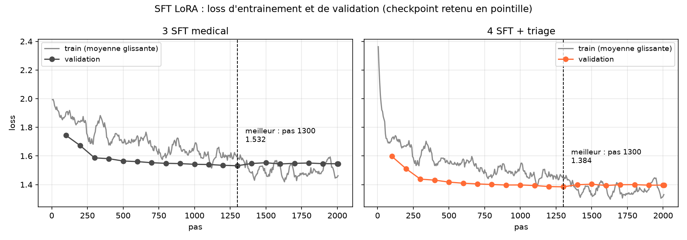
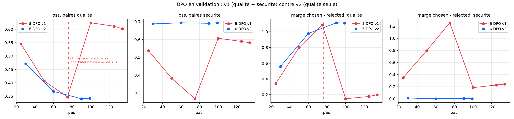
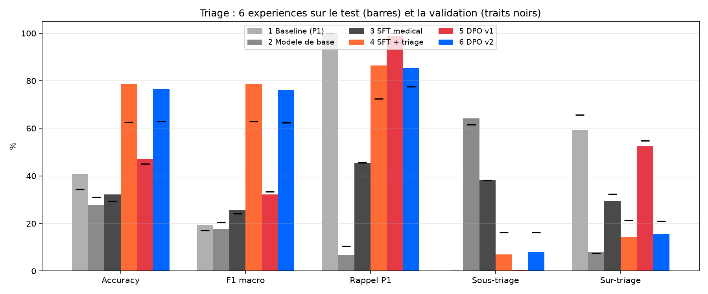
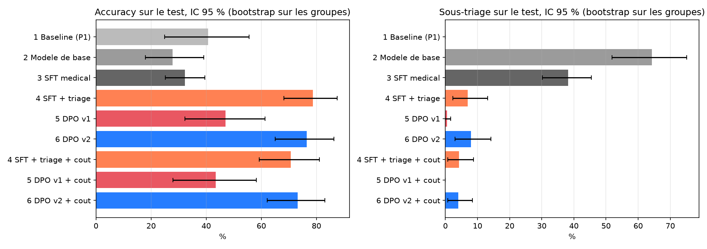
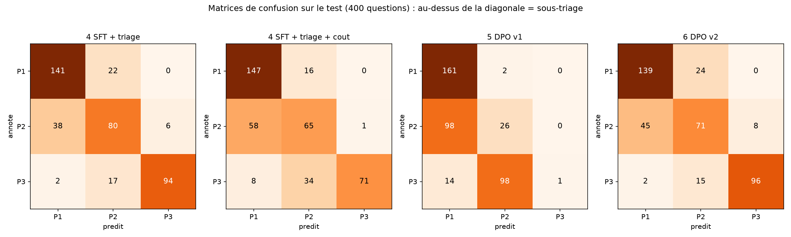
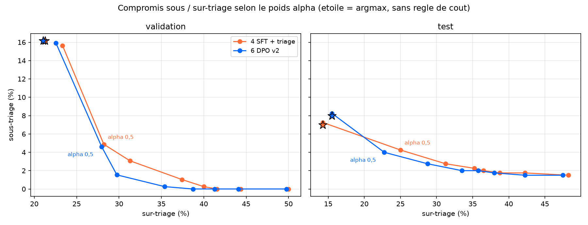
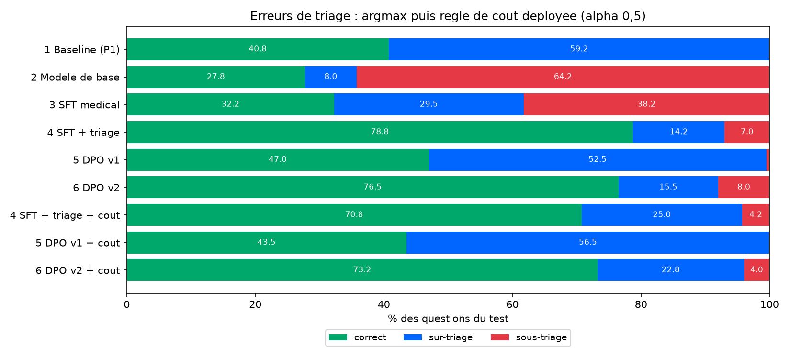
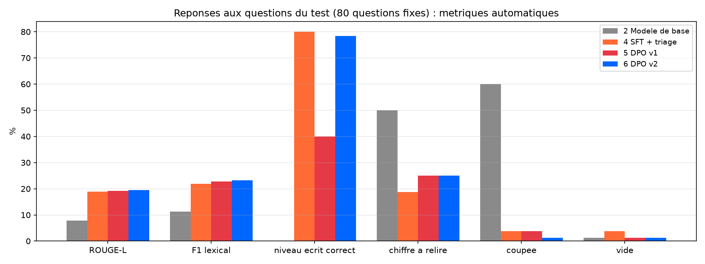
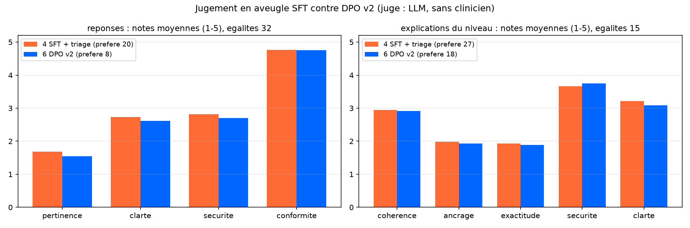

# Partie experimentale SFT / DPO : resultats et interpretation

Document de synthese de la partie experimentale. Il reprend, dans l'ordre, les modeles entraines, les metriques de triage, la regle de decision au cout, la qualite des explications apres DPO, puis l'interpretation et les limites. Le detail chronologique est dans [`experiments.md`](experiments.md), le protocole de triage dans [`comparaison_triage.md`](comparaison_triage.md).

Rappel de l'objectif : demontrer la **faisabilite** d'un agent qui propose un niveau de priorite (P1 urgence maximale, P2 moderee, P3 differee) et une explication globalement coherente. C'est un POC pedagogique, pas un dispositif medical : toute classification et toute explication devraient etre validees par des experts medicaux avant un usage reel.

## Reproduire cette page

Tout ce qui suit se regenere sans GPU a partir des sorties versionnees, sauf la generation des explications :

```bash
python -m triage.evaluation.compare_models                 # tableaux + graphiques (outputs/figures/)
python -m triage.evaluation.evaluate_explanations          # explications SFT et DPO v2 (GPU, ~1 h sur RTX 2060)
python -m triage.evaluation.blind_judgment summarize --set explications
python -m triage.evaluation.explanation_examples           # exemples commentes
```

## 1. Les modeles compares

Meme modele de base (`Qwen/Qwen3-1.7B-Base`), memes splits regroupes par cas clinique, meme methode de prediction (log-probabilite de chaque niveau, mode choisi sur la validation).

| # | Modele | Entrainement | Role |
|---|---|---|---|
| 1 | Baseline naive | aucun, toujours P1 | plancher (rappel P1 100 %) |
| 2 | Modele de base | aucun | apport du fine-tuning |
| 3 | SFT medical | LoRA, reponses sans niveau | apport du domaine medical seul |
| 4 | **SFT medical + triage** | LoRA, niveau en tete des reponses des cas annotes | modele livre |
| 5 | DPO v1 | 4 + DPO, paires qualite et securite triage | penaliser le sous-triage par preference |
| 6 | DPO v2 | 4 + DPO, paires qualite seules | ameliorer les explications sans toucher au triage |

Entrainements : LoRA r 16, alpha 32, q/k/v/o_proj, lr 2e-4, 3 epochs, meilleur checkpoint au pas 1300 (SFT) ; DPO beta 0,1, lr 2e-5, 1 epoch, reference = copie figee de l'adaptateur SFT.



Les deux SFT ont le meme profil : la loss de validation baisse jusqu'au pas 1300 (epoch ~1,9) puis remonte legerement, le checkpoint 1300 est retenu. Le SFT avec triage a une loss plus basse (1,384 contre 1,532) : le prefixe de niveau est court et appris vite.



En DPO, la v2 (qualite seule) fait baisser la loss des paires qualite et monter leur marge (0,56 -> 1,11) **sans rien apprendre sur les paires securite** (loss ~0,69 = log 2, marge ~0) : elle ne touche pas au triage, comme voulu. La v1 apprend les deux, et la marge securite monte a 1,25 : le modele apprend "un niveau plus urgent est toujours prefere". Les points de la v1 apres le pas 75 viennent d'une reprise defectueuse apres une coupure du PC ; l'adaptateur evalue est celui du pas 75 (verifie par md5).

## 2. Triage : metriques et graphiques

Source : [`outputs/triage_eval/comparaison_modeles.md`](../outputs/triage_eval/comparaison_modeles.md). Test : 400 questions, 109 cas, 72 groupes ; validation : 390 questions, 76 groupes.



| Modele (decision argmax) | Acc. val. | Acc. test | F1 test | Rappel P1 | Sous-triage | Sur-triage |
|---|---|---|---|---|---|---|
| 1 Baseline naive | 34,4 | 40,8 | 19,3 | 100,0 | 0,0 | 59,2 |
| 2 Modele de base | 31,0 | 27,8 | 17,7 | 6,7 | 64,2 | 8,0 |
| 3 SFT medical | 29,5 | 32,2 | 25,7 | 45,4 | 38,2 | 29,5 |
| **4 SFT + triage** | **62,6** | **78,8** | **78,7** | 86,5 | 7,0 | 14,2 |
| 5 DPO v1 | 45,1 | 47,0 | 32,1 | 98,8 | 0,5 | 52,5 |
| 6 DPO v2 | 62,8 | 76,5 | 76,3 | 85,3 | 8,0 | 15,5 |



Lecture :

- **Les exemples de triage font le resultat**, pas le fine-tuning medical en soi : le SFT medical (3) reste au niveau du modele de base, le SFT triage (4) gagne 46,5 points d'accuracy (IC 95 % [36,0 ; 55,8]).
- **La DPO v2 conserve le triage** : 76,5 % contre 78,8 % en test, 62,8 % contre 62,6 % en validation. Les intervalles se recouvrent largement ([65,0 ; 86,4] contre [68,1 ; 87,6]) : pas de difference demontrable.
- **La DPO v1 s'effondre vers P1** (sur-triage 52,5 %) : avec des paires securite toujours dans le meme sens, la preference apprise est "plus urgent = mieux", sans contre-exemple.
- Le resultat se cite en **fourchette** : de 63 % (validation) a 79 % (test), avec des jeux de 72 a 76 groupes.



Les erreurs du SFT et de la DPO v2 sont presque toutes d'un seul niveau, **aucun P1 n'est classe P3**. P2 est la classe charniere (rappel 64,5 % pour le SFT) : un cas P2 est souvent confondu avec P1 (38 questions) ou P3 (6).

## 3. Sous-triage et sur-triage : la regle de decision au cout

Piste demandee en mentorat : penaliser differemment sous-triage et sur-triage **sans reentrainer**, en particulier pour les predictions limites. Le modele donne une probabilite par niveau (softmax des log-probabilites, temperature ajustee sur la validation) ; au lieu du niveau le plus probable, on retient celui dont le **cout attendu** est minimal :

| annote \ predit | P1 | P2 | P3 |
|---|---|---|---|
| P1 | 0 | 4 x alpha | 10 x alpha |
| P2 | 1 | 0 | 4 x alpha |
| P3 | 2 | 1 | 0 |

Quand le modele est sur de lui, la decision ne change pas ; elle ne bascule que pour les **cas limites**, ou un niveau moins urgent est a peine plus probable. alpha regle le compromis ; alpha = 0,5 est retenu sur la validation et livre dans `decision_rule.json`.





| Test | Accuracy | Rappel P1 | Sous-triage | Sur-triage |
|---|---|---|---|---|
| 4 SFT, argmax | 78,8 | 86,5 | 7,0 | 14,2 |
| 4 SFT, regle de cout | 70,8 | 90,2 | **4,2** | 25,0 |
| 6 DPO v2, argmax | 76,5 | 85,3 | 8,0 | 15,5 |
| 6 DPO v2, regle de cout | 73,2 | 90,8 | **4,0** | 22,8 |

Lecture :

- La regle **divise le sous-triage par ~1,7 sur le test et par ~3,3 sur la validation** (16,2 % -> 4,9 %), au prix d'un sur-triage plus eleve : c'est le compromis voulu en triage (un patient vu trop tot coute moins qu'une urgence ratee).
- Elle s'applique de la meme facon a la DPO v2, avec un resultat equivalent (73,2 % contre 70,8 % d'accuracy, ecart dans le bruit).
- Le point de fonctionnement (alpha) et la matrice sont des **parametres metier** a fixer avec les urgentistes du CHSA ; un alpha plus fort (1,25, choisi au cout minimal en validation) sur-corrige sur le test (sur-triage 36 %).
- Dans l'API, quand la regle releve le niveau par rapport au plus probable, la decision est signalee `a_revoir` : les cas limites partent vers un humain.

## 4. Qualite des reponses et des explications apres DPO

### 4.1 Reponses aux questions du dataset



Sur 80 questions fixes du test (`outputs/response_eval/qualite_reponses.md`), la DPO v2 ameliore legerement les metriques automatiques (ROUGE-L 19,5 contre 18,9, moins de reponses coupees ou vides) mais produit plus de chiffres absents de la source (25 % contre 18,8 %). Au jugement en aveugle (60 cas), le SFT est prefere 20 fois contre 8 (p = 0,036), surtout sur les cas P2 et P3 ; la DPO l'est sur les P1 (4 contre 2). Les deux modeles repondent mal aux questions d'examen specialisees (pertinence 1,6 a 1,7 / 5).

### 4.2 Explications du niveau de priorite

C'est ce que l'agent produit vraiment : apres le niveau, une explication. `evaluate_explanations` la mesure sur les 60 cas de l'echantillon fixe (20 par niveau), avec la question de l'API et le **niveau annote force** en tete, pour que les deux modeles expliquent le meme niveau (grille : [`evaluation_reponses.md`](evaluation_reponses.md), section 3).

Metriques automatiques ([`qualite_explications.md`](../outputs/explanation_eval/qualite_explications.md)) :

| Modele | Ancrage dans le cas | Chiffre absent du cas | Formulation a risque | Vocabulaire d'un autre niveau | Longueur (mots) | Coupee |
|---|---|---|---|---|---|---|
| 4 SFT + triage | 12,3 | 5,0 | 0 | 1,7 | 26 | 0 |
| 6 DPO v2 | 13,5 | 5,0 | 0 | 0 | 24 | 0 |

Jugement en aveugle ([`jugement_explications.md`](../outputs/explanation_eval/jugement_explications.md), notes de 1 a 5) :



| Modele | Coherence | Ancrage | Exactitude | Securite | Clarte | Prefere |
|---|---|---|---|---|---|---|
| 4 SFT + triage | 2,95 | 1,98 | 1,93 | 3,67 | 3,22 | 27 |
| 6 DPO v2 | 2,92 | 1,93 | 1,88 | 3,75 | 3,08 | 18 |

15 egalites ; test du signe p = 0,23 : **pas de difference significative**. Par niveau : egalite sur P1 (8 / 8), SFT devant sur P2 (9 / 7) et surtout P3 (10 / 3).

Exemples representatifs commentes (un cas par niveau ou chaque modele gagne, plus une egalite) : [`exemples_explications.md`](../outputs/explanation_eval/exemples_explications.md).

Ce que montrent les explications :

- **Le format est tenu** : courtes (~25 mots), jamais coupees, elles reprennent le niveau ("Urgence maximale car...") et sont lisibles en quelques secondes.
- **La coherence avec le niveau est moyenne** (~3 / 5) : l'explication justifie souvent le niveau par un risque general plutot que par les signes du cas ; quelques explications "differee" parlent de risque vital.
- **L'ancrage et l'exactitude sont faibles** (~2 / 5) : le diagnostic sous-jacent est souvent manque (meningite lue comme un traumatisme, hypoglycorachie confondue avec une hypoglycemie, embolie pulmonaire non vue), et des elements absents du cas sont presentes comme des faits (choc avec une tension normale, syndrome depressif).
- **Des affirmations dangereuses** apparaissent chez les deux modeles (corticoides presentes comme salvateurs dans un traumatisme cranien grave, interaction aspirine / AVK non vue).

Conclusion : la DPO v2 apprend bien ses paires (marge 0,56 -> 1,11) mais ce gain ne se transfere pas aux explications du niveau. La limite vient surtout de la taille du modele et des donnees : les references de la DPO sont des corriges d'examen, pas des justifications de triage. Une piste plus directe serait des paires dont le `chosen` est une justification de triage ecrite ou validee par un clinicien, citant les signes du cas.

## 5. Interpretation et choix du modele

| Critere | 4 SFT + triage | 6 DPO v2 | Lecture |
|---|---|---|---|
| Triage test (argmax) | 78,8 % | 76,5 % | equivalent (IC recouvrants) |
| Triage validation | 62,6 % | 62,8 % | equivalent |
| Sous-triage test, regle de cout | 4,2 % | 4,0 % | equivalent |
| QCM FrenchMedMCQA | 50,0 % | 49,1 % | equivalent |
| Reponses, jugement en aveugle | prefere 20 | prefere 8 | SFT devant (p = 0,036) |
| Explications du niveau, jugement en aveugle | prefere 27 | prefere 18 | SFT devant, non significatif (p = 0,23) |
| Chiffres absents de la source (reponses) | 18,8 % | 25,0 % | SFT devant |

- **Modele livre : SFT + triage (checkpoint 1300) avec la regle de decision au cout** (alpha 0,5, temperature 2,25). La DPO v2 conserve le triage, ce qui est le resultat attendu, mais n'ameliore ni les reponses ni les explications : rien ne justifie une etape d'entrainement de plus.
- **La DPO v1 est un contre-exemple instructif** : des preferences asymetriques sur le niveau apprennent "toujours plus urgent". Le compromis sous / sur-triage se regle mieux a la decision, de facon explicite et reglable par le metier, qu'a l'entrainement.
- **Faisabilite demontree** pour le niveau : de 32 % (SFT generaliste) a 63-79 % d'accuracy, aucun P1 classe P3, sous-triage ramene a ~4 % par la regle de cout, cas limites signales pour revue humaine.
- **Faisabilite partielle** pour l'explication : format et coherence globale corrects, contenu medical peu fiable. L'explication doit etre presentee comme une aide a la lecture du cas, jamais comme un avis medical.

## 6. Limites

- **Etiquettes de reference pre-annotees par LLM** selon une grille ecrite, sans validation clinique : les metriques mesurent l'accord avec ces annotations, pas une fiabilite medicale. 50 cas sont prets pour une relecture (`outputs/annotation_review/`).
- **Petits jeux d'evaluation** (72 et 76 groupes de cas) : intervalles larges, ecart de 16 points entre validation et test.
- **Cas d'examen**, pas de vrais dossiers d'urgence ; deux specialites dominent le corpus.
- **Sous-triage residuel** : 4,2 % des questions du test avec la regle de cout, dont des urgences a gravite biologique et une torsion testiculaire predite P2. Un usage reel imposerait une validation humaine systematique.
- **Hallucinations** : un modele de 1,7 milliard de parametres invente des chiffres, des traitements ou des diagnostics ; le jugement en aveugle a releve des conseils dangereux (prostaglandines refusees dans une cardiopathie ducto-dependante, morphine en grammes). L'explication ne doit jamais etre lue comme une prescription : l'API l'ecrit dans chaque reponse.
- **Juge LLM** : le jugement en aveugle est fait par un LLM (Claude), sans clinicien ; ordre aleatoire et grille fermee reduisent ses biais sans les supprimer.

Avant tout usage reel : validation des annotations et des explications par des urgentistes, jeu d'evaluation issu de vrais dossiers du CHSA, matrice de cout validee par le metier, phase pilote en double lecture sans effet sur la prise en charge.
